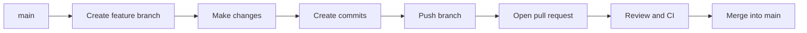

# Day 1 — Git and GitHub Foundations

## What I learned

I learned how to create a Git repository, work on a separate branch, make small commits, push changes, open a pull request, review changes, and merge them into `main`. I also learned why secrets must never be committed to Git.

## Git workflow

## Key concepts

### Merge and rebase

A merge combines the histories of two branches and may create a merge commit. A rebase moves my commits onto a different base and rewrites their commit IDs. I should avoid rebasing commits that other people are already using because rewriting shared history can cause confusion and conflicts.

### Why use `--force-with-lease`?

After rebasing, a normal push may be rejected because the commit history has changed. `--force-with-lease` updates the remote branch only if it has not received changes that I have not seen. It is safer than `--force`, which can overwrite another person's work.

### Secrets in Git history

If I commit a `.env` file and delete it in a later commit, its contents still exist in earlier commits. The exposed secret must be revoked or rotated. Deleting the file alone is not enough.

## Mistake and fix

I initially allowed a tool to generate backend and frontend application files that were outside the Day 1 scope. I undid those changes, removed the generated dependencies, and kept only the required project structure and Git documentation.

## Open question

When should a team prefer a merge commit instead of rebasing a feature branch?